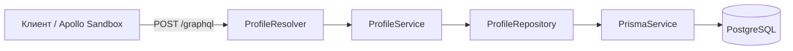

# digital-business-card-backend

## Описание

Бэкенд-часть цифровой визитки, которая презентует разработчика как специалиста, с использованием: git, typescript, Node.js, NestJS, Prisma, GraphQL и Docker.

Приложение предоставляет Apollo Sandbox (GraphQL Playground), через которое можно получить информацию о специалисте, опыте работы, навыках и проектах.

## Стек технологий

| Назначение | Технологии |
| --- | --- |
| Язык и среда выполнения | TypeScript, Node.js 24 |
| Серверное приложение | NestJS 11, Express |
| API | GraphQL, Apollo Server, Apollo Sandbox |
| База данных | PostgreSQL 17, Prisma ORM, драйвер pg |
| Конфигурация и валидация | @nestjs/config, dotenv, Zod |
| Логирование | Pino, nestjs-pino, pino-http |
| Ограничение частоты запросов | @nestjs/throttler |
| Тестирование | Jest, Supertest |
| Качество кода | ESLint, Prettier |
| Контейнеризация | Docker, Docker Compose |
| Контроль версий и размещение | Git, Vercel, Neon PostgreSQL |

## Архитектура

Приложение построено как модульный монолит на NestJS. GraphQL API, бизнес-логика и доступ к данным разделены на слои:



- **ProfileModule** — получение публичного профиля. `ProfileResolver` обрабатывает GraphQL-запрос и преобразует ошибки, `ProfileService` выбирает профиль со slug `main`, `ProfileRepository` загружает его вместе со ссылками, навыками, опытом, проектами и образованием. GraphQL-схема формируется автоматически из TypeScript-моделей и декораторов (code first).
- **DatabaseModule** — подключение к PostgreSQL через `PrismaService` и адаптер `@prisma/adapter-pg`, управление завершением соединений.
- **HealthModule** — HTTP-эндпоинт `/health` для проверки состояния приложения и базы данных.
- **LoggingModule** — структурированное логирование приложения и HTTP-запросов через Pino.
- **RateLimitModule** — ограничение частоты HTTP- и GraphQL-запросов.
- **ConfigModule** — загрузка переменных окружения и их проверка через Zod.

Данные хранятся в связанных таблицах: `Profile`, `ProfileLink`, `Skill`, `Experience`, `Project` и `Education`. Профиль выступает центральной сущностью, с которой связаны остальные записи.

Начальные данные описаны в `prisma/seed-data.ts` и проверяются схемой Zod. Скрипт `prisma/seed.ts` синхронизирует их с базой в одной транзакции: создаёт или обновляет записи через `upsert` и удаляет связанные записи, которых больше нет в seed-данных.

В Docker Compose используются три сервиса: `db` (PostgreSQL), `db-init` (миграции и заполнение базы) и `api` (NestJS). API запускается после готовности базы и успешного завершения `db-init`. Dockerfile использует многоэтапную сборку с отдельными этапами для инициализации базы и запуска приложения.

## Команды запуска

Требования: Node.js 24, npm, Docker и Docker Compose. Команды выполняются из корня проекта.

### Подготовка окружения

Скопируйте `.env.example` в `.env` (PowerShell):

```powershell
Copy-Item .env.example .env
```

Укажите свои параметры `POSTGRES_*`. 

Для локальной базы удалите из `.env` строки `DATABASE_URL=change_me` и `DATABASE_URL_UNPOOLED=change_me`: строка подключения будет собрана из `POSTGRES_*`. 

При использовании внешней базы задайте корректные PostgreSQL URL; `DATABASE_URL_UNPOOLED` используется для миграций и заполнения базы.

### Запуск в Docker

```bash
docker compose up --build -d
docker compose logs -f api
```

Compose запустит PostgreSQL, применит миграции, заполнит базу и запустит API. При `PORT=3000` доступны:

- Apollo Sandbox: `http://localhost:3000/graphql`.
- Проверка состояния: `http://localhost:3000/health`.

Остановка контейнеров с сохранением данных:

```bash
docker compose down
```

### Локальная разработка

База запускается в Docker, приложение — на компьютере. В `.env` укажите `POSTGRES_HOST=127.0.0.1`.

```bash
npm ci
docker compose up -d --wait db
npm run prisma:generate
npm run db:migrate:deploy
npm run db:seed
npm run start:dev
```

После изменения `prisma/seed-data.ts` выполните `npm run db:seed`, чтобы обновить данные в базе.

### Сборка и запуск

После установки зависимостей, генерации Prisma Client и подготовки базы:

```bash
npm run build
npm run start:prod
```

### Проверки

| Команда | Назначение |
| --- | --- |
| `npm run typecheck` | Проверка типов |
| `npm run lint` | Проверка ESLint |
| `npm run format` | Форматирование Prettier |
| `npm test` | Unit-тесты |
| `npm run test:e2e` | E2E-тесты |
| `npm run profile:preview` | Сборка и вывод профиля из базы в консоль |

## API

GET `/` - возвращает строку `Hello World!`.

GET `/health` - проверяет состояние приложения и подключение к базе данных. При успехе возвращает HTTP `200`:

RES:
```json
{
  "status":"ok",
  "database":"up"
}
```

При недоступности базы данных возвращает HTTP `503`:

```json
{
  "status": "error",
  "database": "down"
}
```

GET `/graphql` - открывает Apollo Sandbox в браузере для выполнения GraphQL-запросов.

POST `/graphql` - выполняет GraphQL-запрос. Для JSON-тела запроса укажите заголовок `Content-Type: application/json`.

REQ:
```json
{
  "query":"query GetProfile {\n  profile{\n    name\n  }\n}\n",
  "variables":{},
  "operationName":"GetProfile"
}
```
RES:
```json
{
  "data": {
    "profile": {
      "name": "Fullstack-разработчик Node.js, TypeScript, NestJS and React"
    }
  }
}
```
## Deploy

Доступно по хосту: https://digital-business-card-backend-walkway.vercel.app/

- База данных развернута в Neon: https://console.neon.tech/
- Приложение NejstJS: (Api и инициализация подключения к БД) в Vercel


## Пример полного запроса graphql

```gql
query GetProfile {
  profile {
    name
    description
    links {
      label
      url
    }
    skills {
      name
    }
    experiences {
      company
      position
      startDate
      endDate
      achievements
    }
    projects {
      name
      url
      repositoryUrl
    }
    educations {
      name
      degree
      startDate
      endDate
    }
  }
}
```


## План реализации

1) Настроить окружение: npm, конфигурацию typescript, линтер, форматтер,  запуск сервера.
2) Добавить .env, валидацию Zod и ручку /health.
3) Подключить логирование через pino  (app log, http, masked);
4) Создать compose.yaml для БД (образ, настройки доступа, volume и health);
5) Подклбчить Prisma и в /health добавить статус подключения к БД.
6) Описать ER модели и их связи, индексы + заполнить БД.
7) Попытка получить профиль со связанными таблицами и отображение в консоли.
8) Подключить Apollo (запрос через /graphql)
9) Создать Dockerfile и автозапуск.

